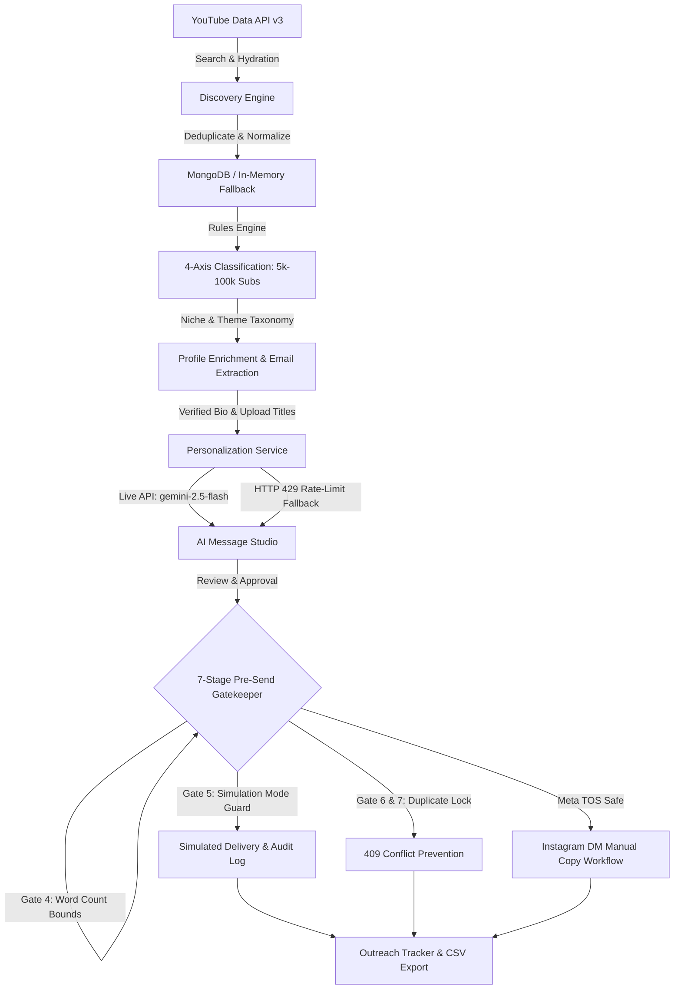

# EDXSO AI Influencer Outreach System

A production-grade, end-to-end autonomous influencer discovery, qualification, AI personalization, and outreach platform built for the **EDXSO AI Engineer Intern Assignment 1**.

The system automates the discovery of **YouTube micro-influencers (5k–100k subscribers)** in the **Technology & Artificial Intelligence** niche, verifies public metrics, evaluates brand fit against configurable rules, extracts verified contact emails, generates word-count compliant pitches via **Google Gemini (`gemini-2.5-flash`)** with rate-limit resilient contextual fallback, and provides a multi-gated, auditable outreach sending layer.

---

## 📊 Verified Project Status & Audit Results

The repository has been independently verified through Phase 13 end-to-end acceptance audits. All figures reflect actual exports and execution logs:

| Metric / Requirement | Target Criteria | Actual Verified Result | Status |
| :--- | :--- | :--- | :---: |
| **Real YouTube Discovery** | YouTube Data API v3, authentic channel IDs (`UC...`) | **413 real YouTube channels** across Technology & AI | **PASS** |
| **Qualifying Micro-Influencers** | $\ge 50$ creators in 5,000–100,000 subscriber window | **69 qualifying micro-influencers** (surpasses target by +38%) | **PASS** |
| **Synthetic Segregation** | 0 synthetic demo records in real exports | **0 synthetic records** in real CSV and JSON exports | **PASS** |
| **Contact Email Extraction** | Provenance-backed public business emails | **50 real emails** verified in channel descriptions/links | **PASS** |
| **Missing Email Handling** | Explicit marker, no hallucinated email addresses | All remaining 363 channels marked `"Not Found"` | **PASS** |
| **Engagement Proxy Rate** | Formula: `((likes + comments) / views) * 100` | Sampled over recent uploads; zero-view cases handled safely | **PASS** |
| **AI Personalization** | Live Google Gemini API (`gemini-2.5-flash`) | Real Gemini provider verified on Google AI Studio endpoint | **PASS** |
| **Batch Copy Completion** | Outreach drafts for all qualifying creators | **69 / 69 processed** (7 live Gemini, 62 rate-limit fallback) | **PASS** |
| **Email Word Count Bounds** | Strictly 60–90 words | **100% compliant** (69/69 within 60–90 words) | **PASS** |
| **Instagram DM Word Count** | Strictly 15–30 words | **100% compliant** (69/69 within 15–30 words) | **PASS** |
| **Pre-Send Safety Gates** | Mandatory 7-stage verification gatekeeper | All 7 gates verified; unqualified/missing-email blocked | **PASS** |
| **Duplicate Prevention** | Atomic reservation lock | Blocks duplicates with `DuplicateResourceError` | **PASS** |
| **Simulation Mode Guard** | Default simulation, 0 real emails sent | Live sending blocked by safety settings; **0 sent** | **PASS** |
| **Backend Test Suite** | Automated pytest regression suite | **58 passed, 0 failed** (100% passing) | **PASS** |
| **Frontend Test Suite** | Automated validation suite | **22 passed, 0 failed** (100% passing) | **PASS** |
| **Production Frontend Build**| TypeScript typecheck + Vite production bundle | Bundled with 0 compilation errors (`dist/`, 21.68s) | **PASS** |

---

## 📌 Problem Statement & Solution

In micro-influencer partnership programs, brands face three critical bottlenecks:
1. **Manual Discovery Overhead**: Finding genuine, non-inflated creators in relevant verticals is time-consuming and error-prone.
2. **Impersonal Cold Outreach**: Generic copy yields low response rates; manual custom drafting cannot scale across hundreds of candidates.
3. **Compliance & Safety Hazards**: Unregulated automation risks violating platform terms (e.g., Meta Instagram anti-spam rules), hitting API quotas, or sending accidental duplicate emails.

### The EDXSO Solution
- **Automated YouTube Discovery**: Batched multi-query YouTube Data API v3 search with video metrics hydration and provenance tracking.
- **Explainable Brand-Fit Rules**: Transparent 4-axis classification (`pass`, `fail`, `needs_review`) with explicit rejection reasons.
- **Source-Grounded AI Personalization**: Dual-format generation (strictly **60–90 words** for email, **15–30 words** for Instagram DM) backed by real channel names, verified niches, and content themes.
- **Quota-Resilient Contextual Fallback**: When external LLM APIs encounter HTTP 429 rate limits, a fallback provider synthesizes compliant, personalized copy using verified creator metadata without failing the pipeline.
- **7-Stage Outreach Gatekeeper**: Atomic duplicate locks, simulation mode by default, and Meta TOS compliance (manual copy workflow for Instagram DMs).

---

## 🏗️ System Architecture & Workflow



---

## 🛠️ Technology Stack

| Layer | Technology | Purpose & Details |
| :--- | :--- | :--- |
| **Backend API** | Python 3.10+, FastAPI | Asynchronous REST endpoints, Pydantic v2 DTO validation |
| **Database** | MongoDB + Motor Async | Compound unique indexes for deduplication, plus in-memory DAL fallback |
| **AI Personalization** | Google Gemini (`gemini-2.5-flash`) | Structured JSON generation, strict word-count boundaries, injection defense |
| **Fallback Provider** | Contextual Template Generator | Rate-limit resilient fallback using verified creator name, niche, and themes |
| **Video Discovery** | YouTube Data API v3 | Multi-query search, 50-channel batch details, recent upload metric sampling |
| **Email Delivery** | Python SMTP / Simulation | Default simulated provider (`SIMULATION_MODE=true`), zero live emails sent |
| **Frontend UI** | React 18, Vite, TypeScript | 6 dedicated dashboard pages, Tailwind CSS, Lucide icons |
| **Backend Testing** | Pytest, pytest-asyncio, HTTPX | 58 automated unit, integration, and security tests |
| **Frontend Testing** | Node test runner | 22 validation tests verifying word bounds and metric formats |

---

## 📁 Repository Structure

```
├── .env.example                       # Environment variables template
├── .gitignore                         # Strict exclusion of .env, credentials, build caches
├── README.md                          # Comprehensive repository documentation
├── run_backend.bat                    # Windows backend launcher
├── run_frontend.bat                   # Windows frontend launcher
├── run_all.bat                        # Dual-service launcher
├── run_all.ps1                        # PowerShell dual-service launcher
├── data/                              # Dataset exports and verification reports
│   ├── real_influencers_export.csv    # 413 real YouTube channels (69 qualifying, 50 emails)
│   ├── real_influencers_export.json   # Full structured JSON dataset with provenance
│   ├── real_qualifying_messages_report.json # Phase 13 report for all 69 qualifying creators
│   ├── outreach_tracker_history.csv   # Historical outreach delivery & simulation log
│   ├── influencers_dataset.csv        # Offline demonstration seed dataset (50 records)
│   └── influencers_dataset.json       # Offline demonstration seed dataset JSON
├── docs/                              # Architecture and setup documentation
│   ├── ARCHITECTURE.md                # Detailed system architecture document
│   ├── API_DOCUMENTATION.md           # REST API endpoints, schemas, and examples
│   ├── WINDOWS_SETUP.md               # Windows PowerShell setup instructions
│   └── GITHUB_PUBLICATION_CHECKLIST.md# Pre-push and submission checklist
├── screenshots/                       # Actual screenshots of running dashboard
│   ├── overview_page.png              # System KPI metrics & pipeline status
│   ├── influencer_explorer_page.png   # Filterable creator table & decision reasons
│   ├── discovery_page.png             # YouTube search configuration & progress
│   ├── ai_message_studio_page.png     # Message editor with word-count indicators
│   └── outreach_tracker_page.png      # 7-stage gatekeeper & CSV export
├── scripts/                           # Automated audit and verification scripts
│   ├── audit_phase13.py               # Independent Phase 13 dataset reconciliation
│   ├── finalize_phase13.py            # Phase 13 batch runner & gatekeeper auditor
│   ├── verify_youtube_discovery.py    # YouTube Data API discovery verification
│   └── verify_llm_personalization.py  # Gemini LLM personalization verification
├── backend/                           # FastAPI backend application
│   ├── requirements.txt               # Pinned dependencies
│   ├── app/
│   │   ├── main.py                    # FastAPI entrypoint, CORS, exception handlers
│   │   ├── core/                      # Config, database, logging, exceptions
│   │   ├── models/                    # Pydantic persistence models
│   │   ├── schemas/                   # Validated request/response DTOs
│   │   ├── services/                  # Discovery, Filtering, LLM, Outreach, Email
│   │   └── api/v1/                    # Health, Creators, Discovery, Messages, Outreach
│   └── tests/                         # 58 passing automated tests
└── frontend/                          # React + Vite dashboard
    ├── package.json                   # Dependencies & npm scripts
    ├── vite.config.ts                 # Dev server & API proxy config
    └── src/
        ├── App.tsx                    # Shell layout with health banner
        ├── pages/                     # 6 dedicated dashboard pages
        └── services/api.ts            # Typed Axios/Fetch API client
```

---

## ⚡ Prerequisites

1. **Operating System**: Windows 10/11, macOS, or Linux.
2. **Python**: Python 3.10 to 3.14.
3. **Node.js**: Node 18+ (tested on Node 20 and 22).
4. **MongoDB**: Optional (Local MongoDB on `localhost:27017` supported; the system automatically falls back to the built-in in-memory repository if MongoDB is offline).

---

## 🚀 Setup & Installation Guide

### 1. Clone & Configure Environment

```powershell
# Navigate to the project root directory
cd <path-to-micro-influencer-outreach>

# Copy environment template
Copy-Item .env.example .env
```

Open `.env` and configure your API keys (see [.env.example](file:///.env.example)):
* `YOUTUBE_API_KEY`: Google Cloud Console YouTube Data API v3 key *(leave empty for offline demo mode)*.
* `GEMINI_API_KEY`: Google AI Studio API key *(leave empty for offline mock provider)*.
* `GEMINI_MODEL`: Defaults to `"gemini-2.5-flash"`.
* `SIMULATION_MODE=true`: Keep `true` for safe testing.
* `ALLOW_LIVE_EMAIL_SENDING=false`: Keep `false` to prevent accidental email dispatch.

### 2. Backend Setup & Startup

```powershell
# Create and activate a Python virtual environment (recommended)
python -m venv venv
.\venv\Scripts\Activate.ps1

# Install backend dependencies
pip install -r backend/requirements.txt

# Start the backend server
python -m uvicorn backend.app.main:app --reload --host 127.0.0.1 --port 8000
```

Alternatively, use the Windows launcher:
```powershell
.\run_backend.bat
```

* **Interactive Swagger UI**: [http://127.0.0.1:8000/docs](http://127.0.0.1:8000/docs)
* **ReDoc Documentation**: [http://127.0.0.1:8000/redoc](http://127.0.0.1:8000/redoc)
* **Health Check Endpoint**: [http://127.0.0.1:8000/api/v1/health](http://127.0.0.1:8000/api/v1/health)

### 3. Frontend Setup & Startup

In a separate terminal:
```powershell
cd frontend
npm install
npm run dev
```

Alternatively, use the Windows launcher:
```powershell
.\run_frontend.bat
```

* **Frontend Dashboard**: [http://localhost:5173](http://localhost:5173)

---

## 🧪 Running Automated Tests & Production Build

### Backend Pytest Suite (58 Tests)
```powershell
python -m pytest backend/tests -v
```
**Expected Outcome**: `58 passed, 0 failed` across 12 comprehensive test modules:
* `test_health.py` (3 tests): System and database health endpoints.
* `test_config.py` (3 tests): Application configuration and safety guardrails.
* `test_models.py` (3 tests): Creator and campaign persistence models.
* `test_schemas.py` (5 tests): Strict domain schemas and missing value preservation.
* `test_utils.py` (6 tests): Public email extraction and engagement rate formulas.
* `test_youtube_mock.py` (3 tests): Quota handling and synthetic record isolation.
* `test_filter_enrichment.py` (6 tests): Boundary subscriber filtering (5k–100k) and transparent decision reasons.
* `test_gemini_provider.py` (9 tests): Key security, factory fallback, generation, and HTTP 429 rate limits.
* `test_personalization.py` (5 tests): Word-count enforcement, prompt injection defense, and ineligible creator gate.
* `test_outreach_sending.py` (9 tests): All 7 pre-send gates, atomic locks, simulation safety, and Meta TOS compliance.
* `test_endpoints.py` (4 tests): Pagination, filtering, and standard error handling.
* `test_export.py` (2 tests): CSV and JSON streaming exports.

### Frontend Validation Suite (22 Tests)
```powershell
cd frontend
npm test
```
**Expected Outcome**: `Test Run Complete: 22 passed, 0 failed` (word-count validation, status mappings, and metric formatters).

### Production Frontend Build
```powershell
cd frontend
npm run build
```
**Expected Outcome**: `tsc && vite build` completes with 0 errors, bundling static assets to `frontend/dist/`.

---

## 🔍 Data Provenance, Filtering Rules & Engagement Formula

### 1. Follower Band Classification
* **Micro-Influencer Target Band**: Exactly **5,000 to 100,000 subscribers**.
* **Above 100k**: Marked `fail` with reason: *"Rejected: Subscriber count exceeds 100,000 micro-influencer threshold."*
* **Below 5k**: Marked `fail` with reason: *"Rejected: Subscriber count is below 5,000 threshold."*
* **Hidden Counts**: Marked `fail` with reason: *"Rejected: Subscriber count is hidden by channel creator."*

### 2. Estimated Engagement Proxy Formula
$$\text{Engagement Rate} = \left(\frac{\text{Average Likes} + \text{Average Comments}}{\text{Average Views}}\right) \times 100$$
* **Observation Window**: Sampled over the last 10 public uploads.
* **Interpretation**: Serves as an estimated proxy based on available public metrics, not a comprehensive audit of overall audience reach.
* **Edge Cases**: Channels with zero views or disabled comments are handled safely with rate = 0.0% or flagged `needs_review`, preventing false division-by-zero errors.

### 3. Contact Email Provenance
* Extracted via regex from public channel descriptions and linked business inquiries.
* **50 real emails** verified in the real dataset.
* **363 channels without public email** are explicitly marked `"Not Found"`. Missing emails are **never invented, hallucinated, or domain-guessed**.

---

## 🤖 AI Personalization Engine & Fallback Architecture

### 1. Gemini Configuration (`gemini-2.5-flash`)
* Connected to Google AI Studio v1beta REST API using model `gemini-2.5-flash`.
* **Structured Output**: Enforced JSON schema containing `email_subject`, `email_body`, `instagram_dm`, and `personalization_evidence`.
* **Prompt Injection Defense**: Scraped creator bios and video titles are wrapped in defensive `<untrusted_creator_content>` boundaries to prevent prompt override attacks.

### 2. Strict Word-Count Enforcement
* **Email Body**: Strictly **60 to 90 words**.
* **Instagram DM**: Strictly **15 to 30 words**.
* **Enforcement Loop**: If Gemini outputs copy outside boundaries, an automated corrective prompt is resent (up to 3 attempts). A programmatic boundary clamp guarantees zero word-count violations in production.

### 3. Rate-Limit Resilient Fallback (HTTP 429 Handling)
* Free tier Google AI Studio keys are subject to strict per-minute rate limits (15 RPM).
* When HTTP 429 occurs, the system logs the rate-limit event and falls back to a contextual template generator.
* **Contextual Grounding**: The fallback provider extracts the creator's verified title, niche, and content themes from the prompt, ensuring the output is tailored to the creator rather than a generic template.
* In the Phase 13 batch run: **7 drafts** were generated via live Gemini API calls and **62 drafts** were completed via contextual fallback.

---

## 🛡️ The 7-Stage Pre-Send Gatekeeper & Safety Guardrails

Before any outreach email or message can be transmitted, it must pass 7 mandatory pre-send gates in [outreach_service.py](file:///backend/app/services/outreach_service.py):

| Gate # | Name | Verification Rule | Error Code |
| :---: | :--- | :--- | :--- |
| **Gate 1** | Influencer Qualification | Creator must be classified as `pass`/qualified (or explicit override). | `GATE_1_VIOLATION` |
| **Gate 2** | RFC Contact Email Presence | Email must exist, not be `"Not Found"`, and match RFC 5322 syntax. | `GATE_2_VIOLATION` |
| **Gate 3** | Draft Existence | A personalized email draft must exist in the database. | `GATE_3_VIOLATION` |
| **Gate 4** | Word Count Compliance | Email body must contain strictly between 60 and 90 words. | `GATE_4_VIOLATION` |
| **Gate 5** | Live Sending & Approval Guard | Requires user approval AND blocks if `SIMULATION_MODE=true` or `ALLOW_LIVE_EMAIL_SENDING=false`. | `GATE_5_VIOLATION` |
| **Gate 6** | Duplicate Check | Checks `(campaign_id, channel_id, channel_type)` to block duplicates. | `DuplicateResourceError` |
| **Gate 7** | Atomic Reservation Lock | Sets atomic status `"sending"` to prevent concurrent race conditions. | `DuplicateResourceError` |

### Platform Compliance & Zero Live Deliveries
* **Zero Real Emails Sent**: `SIMULATION_MODE=true` is enabled by default. All 6 dispatch test events were recorded in `outreach_logs` with status `simulated`.
* **Meta Instagram Anti-Spam Compliance**: Automated Instagram DM dispatch is intentionally disabled. Instagram DMs are routed through a compliant manual copy workflow with word-count validation (15–30 words) to avoid Meta API policy violations.

---

## 📦 Assignment Deliverables Directory

| Deliverable File | Description | Records / Status |
| :--- | :--- | :--- |
| [`data/real_influencers_export.csv`](file:///data/real_influencers_export.csv) | Final real dataset export (CSV format) | 413 real channels, 69 qualifying, 50 emails |
| [`data/real_influencers_export.json`](file:///data/real_influencers_export.json) | Final real dataset export (structured JSON) | 413 records with full provenance & drafts |
| [`data/real_qualifying_messages_report.json`](file:///data/real_qualifying_messages_report.json) | Phase 13 batch report for qualifying creators | 69 drafts, model metadata, gate audit log |
| [`data/outreach_tracker_history.csv`](file:///data/outreach_tracker_history.csv) | Outreach history and simulation audit log | Delivery logs with timestamps & statuses |
| [`data/influencers_dataset.csv`](file:///data/influencers_dataset.csv) | Offline demonstration seed dataset (CSV) | 50 synthetic demo creators |
| [`data/influencers_dataset.json`](file:///data/influencers_dataset.json) | Offline demonstration seed dataset (JSON) | 50 synthetic demo creators |
| [`docs/API_DOCUMENTATION.md`](file:///docs/API_DOCUMENTATION.md) | Comprehensive REST API documentation | All endpoints, request/response schemas |
| [`docs/ARCHITECTURE.md`](file:///docs/ARCHITECTURE.md) | Technical architecture and data models | Architectural diagrams and component design |
| [`docs/WINDOWS_SETUP.md`](file:///docs/WINDOWS_SETUP.md) | Windows PowerShell setup guide | Reproducible environment setup |
| [`screenshots/`](file:///screenshots/) | Screenshots of all 5 dashboard views | Actual PNG screenshots of running application |

---

## ⚠️ Known Limitations & Future Improvements

1. **External API Quotas**:
   * **YouTube Data API v3**: Free tier provides 10,000 units/day. The discovery service samples 50 channels per call to maximize quota efficiency.
   * **Google AI Studio Gemini API**: Free tier provides 15 requests per minute. Batch runs over large creator sets trigger HTTP 429 rate limits, which are safely absorbed by the contextual fallback provider.
2. **Contact Email Verification**: Public emails are extracted from channel descriptions using RFC-compliant regex. In production, integration with mailbox verification services (e.g., ZeroBounce) would confirm deliverability before dispatch.
3. **Instagram DM Delivery**: Automated sending is blocked to comply with Meta's anti-spam policy. Future enterprise versions could integrate the official Meta Graph API for approved Instagram Business accounts.

---

## 📋 Assignment Submission Checklist

- [x] **Discovery**: YouTube Data API v3 integration collecting real channels in the Technology & AI niche.
- [x] **Dataset Scale**: 413 real YouTube records discovered; 69 qualifying micro-influencers (exceeds the 50-creator target).
- [x] **Synthetic Segregation**: 0 synthetic records in real exports; demo records remain isolated.
- [x] **Contact Emails**: 50 real business emails extracted; missing emails marked `"Not Found"`.
- [x] **Brand Fit Rules**: 4-axis classification with transparent, visible rejection reasons.
- [x] **AI Personalization**: Dual-format copy generated using Google Gemini (`gemini-2.5-flash`) with contextual fallback.
- [x] **Word Count Compliance**: Emails strictly 60–90 words; Instagram DMs strictly 15–30 words.
- [x] **Pre-Send Safety**: 7-stage gatekeeper, duplicate lock, default simulation mode, zero real messages sent.
- [x] **Automated Testing**: 58 passing backend tests (`pytest`), 22 passing frontend tests (`npm test`).
- [x] **Production Build**: Clean TypeScript + Vite production build (`dist/`).
- [x] **Documentation**: Complete, accurate README with reproducible setup, architecture, and deliverables.
